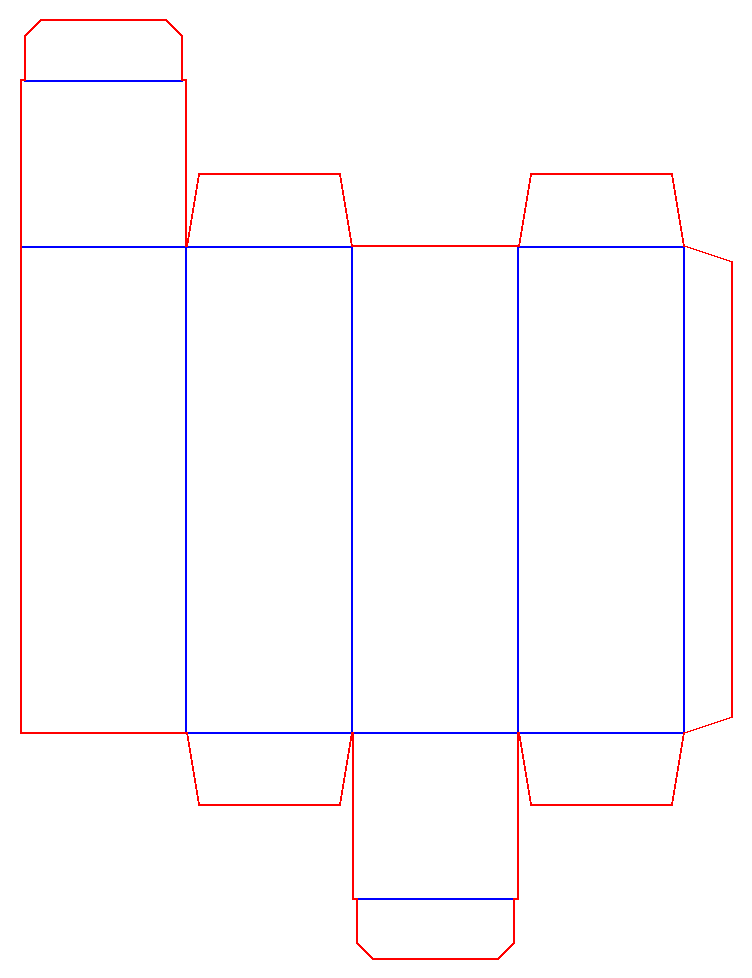

# Assignment 2 — Rocket Design in Tinkercad

## What was the goal?

The goal was to explore basic 3D modelling in Tinkercad by creating two different rocket designs and comparing their shapes, proportions, and visual details.

## What did I do?

I created two rocket models in the same Tinkercad workspace.

The first has a tall, narrow pink body, a light blue nose, and dark blue fins. It explores a simple, elongated rocket shape.

The second has a shorter, rounded white body, a red nose, three orange circular windows, and dark blue fins. It takes a more playful approach to the same theme.

I exported the models together as an STL file and uploaded the file to my GitHub repository.

## What tools and materials did I use?

I used Tinkercad’s browser-based 3D design workspace and geometric shapes to build the models. I used GitHub to store the exported STL file and document the project.

The project required a computer and an internet connection. No physical materials were used at this stage.

## What went wrong?

When adding the model to my website, I had two different STL files in the repository. One contained the actual rocket models, while the other was an almost empty file created separately.

The download link initially pointed to the empty file instead of the actual model.

## What did I change? How did I solve the problem?

I checked the files on GitHub and identified the actual model file by its size and its 3D preview, which displayed both rockets.

I updated the documentation to link to that file. I also placed the assignment documentation inside the docs folder and connected the page through the website’s assignment sidebar.

## What was the result?

I completed two visually distinct rocket models and exported them together as an STL file.

The project helped me explore how changes in proportions, colours, and details can create different designs based on the same theme. The models are available through the link below.

## What could be improved?

Before 3D printing, I would inspect the alignment of the nose and body, the spacing of the fins, and the connections between components.

I would also check the dimensions and thickness of smaller features to assess whether they are suitable for printing.

## 3D Model

[View and rotate the two rocket models on GitHub](https://github.com/Koros1/digital-fabrication/blob/main/Selen%20Koro-%20Roket%20Tasarımı.stl)

The STL file contains the geometry of both rockets. The original Tinkercad colours are not preserved in STL format.

---

# Box Design — Laser-Cut Rocket Holder

## What was the goal?

The next stage of Assignment 2 was to design a box that could hold my unassembled rocket design. The box needed to be laser cut from cardboard using cut and score lines, and it needed to fold up into a shape large enough to contain the rocket pieces.

## What did I do?

I designed the box as a flat net made of cut lines (the outer silhouette and tabs, cut all the way through the cardboard) and score lines (the fold lines, lightly scored so the cardboard bends cleanly without cutting through).

The net folds into a tall rectangular box with a roughly 41.5 mm × 41.5 mm cross-section and a height of about 121.5 mm, large enough to fit the unassembled rocket inside. I exported the design as separate cut and score files, a combined cut-and-score file, and a simplified 3D model showing the folded shape and overall dimensions.

## What tools and materials did I use?

I used vector design software to draw the cut and score paths, then a laser cutter to cut the net out of cardboard. I used GitHub to store the exported files and document the project, the same way I did for the rocket models.

## What went wrong?

*(Add your own notes here — for example, any issues with the laser cutter settings, the fit between the box and the rocket, or problems with the cut/score lines.)*

## What did I change? How did I solve the problem?

*(Add what you changed to fix the issue above.)*

## What was the result?

I produced a foldable cardboard box sized to hold the unassembled rocket, cut and scored on the laser cutter from a single flat sheet.

## What could be improved?

*(Add anything you'd check or adjust next time — for example, tab sizes, glue area, or tolerances for the cardboard thickness.)*

## Design Files

The diagram above shows the box net: red lines are cut paths and blue lines are score (fold) lines.

- [3D model of the box (STL)](https://github.com/Koros1/digital-fabrication/blob/main/box-design/kutu_3d.stl)
- [Cut file (DXF)](https://github.com/Koros1/digital-fabrication/blob/main/box-design/kutu_cut.dxf) · [Cut file (SVG)](https://github.com/Koros1/digital-fabrication/blob/main/box-design/kutu_cut.svg)
- [Score file (DXF)](https://github.com/Koros1/digital-fabrication/blob/main/box-design/kutu_score.dxf) · [Score file (SVG)](https://github.com/Koros1/digital-fabrication/blob/main/box-design/kutu_score.svg)
- [Combined cut + score file (DXF)](https://github.com/Koros1/digital-fabrication/blob/main/box-design/kutu_cut_score_birlesik.dxf) · [Combined cut + score file (SVG)](https://github.com/Koros1/digital-fabrication/blob/main/box-design/kutu_cut_score_birlesik.svg)
